# Abdallah Mohsen

**Senior Flutter Developer · Mobile Engineer · iOS & Android**

I’m a mobile engineer based in Egypt with 4+ years of experience building and shipping Flutter apps. I work across feature development, native integrations, automated testing, and App Store and Google Play releases.

> **Open to Senior Flutter Developer and Senior Mobile Engineer roles. Available to start immediately.**

[Portfolio][portfolio] · [LinkedIn][linkedin] · [Email][email]

[Featured apps](#featured-apps) · [Engineering toolkit](#engineering-toolkit)

## Featured apps

Expand a project to see the workflows I worked on and its App Store listing where available.

### Real-time communication

<strong>Snapcalls</strong> · Voice, video &amp; chat

Built voice and video calling, chat, and group conferencing. Integrated native iOS CallKit for the incoming call experience.

[View Snapcalls on the App Store][snapcalls]

### Healthcare

<strong>Hospedale</strong> · Patient app

Worked on the patient side of the healthcare platform, including booking appointments, coordinating visits, and communicating with providers.

[View Hospedale on the App Store][hospedale]

<strong>Hospedale Provider</strong> · Appointments &amp; medical reports

Worked on the companion app for healthcare providers, including appointment management, patient visit tracking, and medical report workflows.

[View Hospedale Provider on the App Store][hospedale-provider]

### Commerce & real estate

<strong>Swaa</strong> · Shopping &amp; auctions

Built customer-side workflows for product discovery, shopping, and bidding in auctions.

[View Swaa on the App Store][swaa]

<strong>Swaa Vendor</strong> · Merchant operations

Built the merchant side of the marketplace, with workflows for managing products, inventory, and customer orders.

[View Swaa Vendor on the App Store][swaa-vendor]

<strong>Karballa</strong> · Real estate

Contributed Flutter mobile development to a real estate project.

### Workforce management

<strong>Tamam Attendance</strong> · Employee attendance &amp; time tracking

Developed employee check-in and check-out, attendance reporting, and time-tracking workflows.

[View Tamam Attendance on the App Store][tamam]

<strong>Tamam Flex</strong> · Temporary workforce attendance

Worked on attendance flows for temporary workers, with sign-in through accounts assigned by a company administrator.

## Engineering toolkit

| Area | Tools and practices |
| --- | --- |
| Mobile & architecture | Flutter, Dart, Clean Architecture, BLoC/Cubit, Riverpod |
| Integrations | Firebase, REST APIs, payment gateways, native iOS CallKit |
| Quality & release | Unit, widget, and integration tests, GitLab CI, App Store and Google Play releases |
| Team delivery | Code reviews, pairing with junior developers, collaboration with design, backend, and QA |

[portfolio]: https://abdallah-mohsen-jet.vercel.app/
[linkedin]: https://www.linkedin.com/in/abdallah-mohsen-112329363/
[email]: mailto:abdallahmohsen144@gmail.com
[snapcalls]: https://apps.apple.com/sa/app/snapcalls/id6757955965
[hospedale]: https://apps.apple.com/vn/app/hospedale/id6775408452
[hospedale-provider]: https://apps.apple.com/ng/app/hospedale-provider/id6804744644
[swaa]: https://apps.apple.com/vn/app/%D8%B3%D9%88%D8%A7/id6806634005
[swaa-vendor]: https://apps.apple.com/eg/app/%D8%B3%D9%88%D8%A7-%D8%A7%D9%84%D8%A8%D8%A7%D8%A6%D8%B9/id6813179729
[tamam]: https://apps.apple.com/de/app/tamam-attendance/id6775738802
